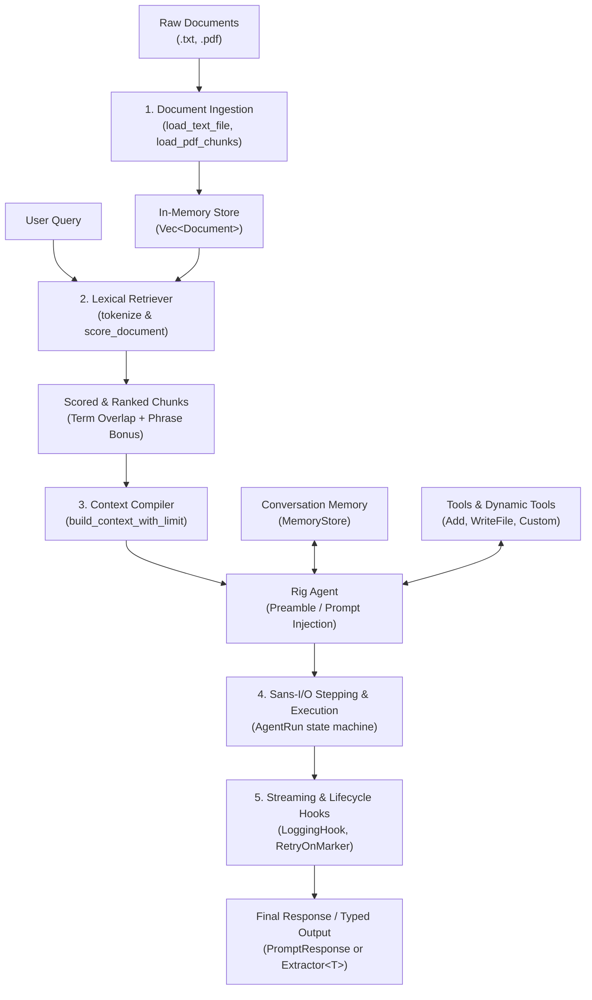

# Vectorless RAG Agent

A high-performance, deterministic **Vectorless Retrieval-Augmented Generation (RAG)** agent built with Rust and the [Rig](https://github.com/0xPlaygrounds/rig) framework.

Unlike traditional RAG systems, **this project does not use embeddings, vector databases, or approximate nearest-neighbor (ANN) search**. Instead, it uses fast in-memory lexical retrieval, token-budgeted prompt compilation, multi-turn conversation memory, dynamic tool execution, sans-I/O stepping, and real-time streaming lifecycle hooks.

---

## Table of Contents

- [Why Vectorless RAG?](#why-vectorless-rag)
- [Architecture & Workflow](#architecture--workflow)
  - [Workflow Overview](#workflow-overview)
  - [Detailed Phase Breakdown](#detailed-phase-breakdown)
    - [Phase 1: Document Ingestion & Chunking](#phase-1-document-ingestion--chunking)
    - [Phase 2: Vectorless Lexical Scoring & Retrieval](#phase-2-vectorless-lexical-scoring--retrieval)
    - [Phase 3: Context Compilation & Character Budgeting](#phase-3-context-compilation--character-budgeting)
    - [Phase 4: Agent Reasoning, Dynamic Tools & Stepping](#phase-4-agent-reasoning-dynamic-tools--stepping)
    - [Phase 5: Multi-Turn Conversation Memory](#phase-5-multi-turn-conversation-memory)
    - [Phase 6: Streaming Execution & Composable Hooks](#phase-6-streaming-execution--composable-hooks)
    - [Phase 7: Typed Schema Extraction](#phase-7-typed-schema-extraction)
- [Vectorless RAG vs. Vector-Based RAG](#vectorless-rag-vs-vector-based-rag)
- [Module Architecture](#module-architecture)
- [Quickstart & Code Examples](#quickstart--code-examples)
  - [1. Ingest Documents and Lexical Search](#1-ingest-documents-and-lexical-search)
  - [2. Fold Context into an Agent Preamble](#2-fold-context-into-an-agent-preamble)
  - [3. Multi-Turn Conversation with In-Memory State](#3-multi-turn-conversation-with-in-memory-state)
  - [4. Sans-I/O Stepping with Pause & Resume](#4-sans-io-stepping-with-pause--resume)
- [Building & Testing](#building--testing)
- [Running the CLI Streaming Example](#running-the-cli-streaming-example)
- [Progress & Status](#progress--status)

---

## Why Vectorless RAG?

Standard RAG architectures introduce considerable complexity and operational overhead:
1. **Infrastructure Debt**: Requires dedicated vector databases (e.g., Pinecone, Qdrant, Milvus, pgvector).
2. **Embedding Latency & Cost**: Every document chunk and every search query must be passed through a neural embedding model (e.g., OpenAI `text-embedding-3`, Cohere, Voyage), incurring API costs and network round-trips.
3. **Semantic Drift & Keyword Blindness**: Cosine similarity in high-dimensional vector spaces frequently struggles with exact entity names, model identifiers, error codes, domain-specific acronyms, and alphanumeric keys.
4. **Non-Determinism**: Semantic clustering can yield varying nearest-neighbors depending on chunking and indexing parameters.

**Vectorless RAG** sidesteps these drawbacks entirely:
- **Zero External Dependencies**: Operates 100% in-memory with pure Rust data structures.
- **Microsecond Scoring**: Uses fast lexical term matching, term-frequency overlap, and exact phrase boosting.
- **Exact Keyword Fidelity**: Accurately matches code identifiers, technical jargon, and IDs without semantic dilution.
- **Budget-Enforced Context**: Intelligently trims and limits context size before injecting into LLM preambles or prompts.

---

## Architecture & Workflow

### Workflow Overview

The vectorless RAG pipeline consists of seven distinct phases:



---

### Detailed Phase Breakdown

#### Phase 1: Document Ingestion & Chunking
- **Location**: `src/documents.rs`
- **Data Model**: Documents are represented by the unified `Document` struct:
  ```rust
  pub struct Document {
      pub id: String,          // Unique identifier or source path with chunk index
      pub title: String,       // Human-readable title or file stem
      pub text: String,        // Raw extracted text content
      pub source_path: PathBuf // Original file path
  }
  ```
- **Loaders**:
  - `load_text_file`: Ingests UTF-8 plain text files directly.
  - `load_pdf`: Ingests multi-page PDF documents and combines text across pages.
  - `load_pdf_chunks`: Splits PDF content into discrete chunks (default ~2,000 characters per chunk) across whitespace boundaries, assigning deterministic chunk IDs (e.g., `doc.pdf#0`, `doc.pdf#1`).

#### Phase 2: Vectorless Lexical Scoring & Retrieval
- **Location**: `src/retrieval.rs`
- **Engine**: The `Retriever` struct manages collections of `Document` records and executes keyword-based retrieval without vector indices or embedding APIs.
- **Tokenization Algorithm (`tokenize`)**:
  - Converts input strings to lowercase.
  - Splits text across all non-alphanumeric character boundaries (`!c.is_alphanumeric()`).
  - Filters out empty tokens into discrete search terms.
- **Scoring Algorithm (`score_document`)**:
  For each document against a user query:
  1. **Token Overlap Frequency**: Counts exact matches of query tokens within the document's combined title and body tokens.
  2. **Substring Fallback**: If a query token did not produce an identical token match but exists as a substring within the lowercase haystack, an additional score point is granted (+1).
  3. **Exact Phrase Bonus**: If the full trimmed query appears verbatim in the document text, a significant phrase bonus is added: `query_tokens.len() * 2`.
- **Ranking & Filtering (`search_documents`, `search_top`)**:
  - Retains only candidate documents with a relevance score `> 0`.
  - Sorts candidates descending by score, maintaining stable ordering on ties.
  - Returns the top-k matches (`search_top(query, limit)`).

#### Phase 3: Context Compilation & Character Budgeting
- **Location**: `src/documents.rs`, `src/retrieval.rs`
- **Budgeting Engine (`build_context_with_limit`)**:
  To protect LLM context windows and prevent runaway prompt sizes, retrieved documents are compiled under strict length constraints:
  - **Per-Document Ceiling**: Each document chunk is capped at 1,000 characters. If a chunk exceeds this limit, it is cleanly truncated with an ellipsis (`…`).
  - **Global Context Ceiling**: The total compiled context block is constrained to a configurable maximum (default: 8,000 characters). Subsequent blocks are truncated or omitted if they exceed the remaining character budget.
  - **Markdown Structure**: Each retrieved segment is formatted with clear markdown metadata headers:
    ```markdown
    ### Document Title
    (id: path/to/file#chunk)
    Document text content...
    ```
- **Injection Methods**:
  - `preamble_with_documents`: Prepends the formatted context block directly into the agent's system preamble.
  - `lookup_context`: Folds the formatted context into the user's prompt string: `[Context]\n\n[User Prompt]`.
  - `ContextHook`: Uses Rig's composing hook interface (`RequestPatch::extra_context`) to dynamically inject context on a per-turn basis.

#### Phase 4: Agent Reasoning, Dynamic Tools & Stepping
- **Location**: `src/agent.rs`, `src/stepping.rs`, `src/tools.rs`
- **Agent Initialization**: Built using Rig's `AgentBuilder` over any supported completion provider (`openai`, `anthropic`, `gemini`, `deepseek`, etc.).
- **Tool Integration**:
  - Supports static typed tools (`Add`, `WriteFile`) implementing Rig's `Tool` trait.
  - Supports dynamic runtime tools (`DynamicTool`) registered via `.dynamic_tools(...)`.
  - Provides `ForceToolOnFirstTurn` hook to enforce `ToolChoice::Required` on the initial turn, ensuring the model performs retrieval or computation before answering.
- **Sans-I/O Stepping Loop (`drive_turns`)**:
  - Uses Rig's state-machine runner (`AgentRun`).
  - Evaluates `AgentRunStep::CallModel` with historical messages and tool definitions.
  - Intercepts invalid or hallucinated tool names and applies recovery actions (`InvalidToolCallAction::fail()`).
  - **State Pause & Resume**: When tools are pending (`AgentRunStep::CallTools`), the entire run state can be serialized to JSON (`serde_json::to_string`), saved/transported, and resumed seamlessly (`serde_json::from_str`) before executing calls.

#### Phase 5: Multi-Turn Conversation Memory
- **Location**: `src/memory.rs`
- **In-Memory Store (`MemoryStore`)**:
  - Leverages Rig's conversation memory module to maintain dialogue history across multiple conversational turns.
  - Does not require a vector store for memory summarization; histories are maintained as discrete, structured `Message` lists.
  - Easily attached to any agent builder via `attach_memory(builder, store)`.

#### Phase 6: Streaming Execution & Composable Hooks
- **Location**: `src/hooks.rs`, `src/streaming_chat.rs`, `src/main.rs`
- **Streaming Pipeline**:
  - Consumes `MultiTurnStreamItem` events in real-time.
  - Supports partial argument streaming: decodes JSON argument fragments as they arrive (`parse_partial_arguments`) before the tool execution completes.
- **Composable Lifecycle Hooks**:
  - `LoggingHook`: Non-intrusive lifecycle hook that monitors prompts, model completions, token usages, and tool results.
  - `RetryOnMarker`: Automatically detects error markers or unsatisfactory model responses, injecting corrective feedback prompts up to a configured per-run retry ceiling.
  - `Tool Result Classification`: Intercepts tool execution errors, categorizes failure modes, and guides agent recovery.

#### Phase 7: Typed Schema Extraction
- **Location**: `src/extractor.rs`
- **Structured Outputs**:
  - Uses `ExtractorBuilder::<T>::new(model).build()` to extract strongly-typed Rust data structures (e.g., `Person`, entity records) directly from retrieved text.
  - Validates output using JSON schema definitions generated by `schemars`, ensuring deterministic schema compliance without vector post-processing.

---

## Vectorless RAG vs. Vector-Based RAG

| Dimension | Vector-Based RAG | Vectorless RAG (This Project) |
| :--- | :--- | :--- |
| **Indexing Mechanism** | Vector database (Qdrant, Pinecone, pgvector) | Plain in-memory Rust structures (`Vec<Document>`) |
| **Representation** | Dense floating-point vectors (e.g., 1536-dim embeddings) | Raw text tokens, titles, and IDs |
| **Retrieval Method** | Approximate Nearest Neighbors (ANN) / Cosine similarity | Term frequency overlap + substring + phrase bonus |
| **External Dependencies** | Embedding models, vector DB servers, native C-libs | **Zero external dependencies** (Pure Rust) |
| **Latency** | Network latency to embedding API + vector query | **Microsecond-level** in-memory keyword scoring |
| **Cost** | Embedding API costs per ingestion & per query | **$0 retrieval cost** (model completion tokens only) |
| **Exact Term Precision** | Often misses exact acronyms, IDs, variable names | **100% exact keyword & phrase fidelity** |
| **Context Window Control**| Requires secondary re-ranking or top-k truncation | Strict per-doc (1,000 char) and global (8,000 char) budgeting |
| **State Portability** | Complex vector sync across sessions | JSON-serializable sans-I/O stepping (`AgentRun`) |

---

## Module Architecture

| Module | File | Primary Responsibility |
| :--- | :--- | :--- |
| `documents` | [src/documents.rs](src/documents.rs) | `Document` model, text/PDF loaders, chunking, context formatting & character budgeting |
| `retrieval` | [src/retrieval.rs](src/retrieval.rs) | `Retriever` struct, tokenization, lexical overlap scoring, phrase bonus, top-k ranking |
| `agent` | [src/agent.rs](src/agent.rs) | Minimal agents, multi-turn agents, dynamic tool registration, forced first-turn hooks |
| `memory` | [src/memory.rs](src/memory.rs) | In-memory conversation memory helpers wrapping Rig's `MemoryStore` |
| `stepping` | [src/stepping.rs](src/stepping.rs) | Sans-I/O hand-driven agent loop (`drive_turns`), run serialization & pause/resume |
| `hooks` | [src/hooks.rs](src/hooks.rs) | Composable hooks: `LoggingHook`, `ContextHook` (passive RAG), `RetryOnMarker` |
| `streaming_chat` | [src/streaming_chat.rs](src/streaming_chat.rs) | Streamed execution over conversation histories, stream item collector |
| `extractor` | [src/extractor.rs](src/extractor.rs) | Zero-vector typed schema extraction (`Extractor<T>`) |
| `tools` | [src/tools.rs](src/tools.rs) | Example tools (`Add`, `WriteFile`) with execution tracking |
| `main` | [src/main.rs](src/main.rs) | CLI entrypoint demonstrating streaming tool argument fragments across LLM providers |

---

## Quickstart & Code Examples

### 1. Ingest Documents and Lexical Search

```rust
use vectorless_rag::documents::Document;
use vectorless_rag::retrieval::Retriever;
use std::path::PathBuf;

// Ingest documents in memory
let docs = vec![
    Document::new("doc-1", "Architecture", "Vectorless RAG uses lexical retrieval.", PathBuf::from("arch.txt")),
    Document::new("doc-2", "Storage", "No vector database or embeddings are required.", PathBuf::from("store.txt")),
];

let retriever = Retriever::new(docs);

// Score and retrieve the top document matching a query
let results = retriever.search_top("lexical retrieval", 1);
assert_eq!(results.len(), 1);
assert_eq!(results[0].title, "Architecture");

// Format retrieved documents into an LLM-ready context block
let context_str = retriever.format_context(&results);
println!("{context_str}");
```

### 2. Fold Context into an Agent Preamble

```rust
use rig::providers::openai::{self, OpenAI};
use vectorless_rag::documents::preamble_with_documents;
use vectorless_rag::retrieval::Retriever;

#[tokio::main]
async fn main() -> anyhow::Result<()> {
    let retriever = Retriever::new(/* ... documents ... */);
    let top_docs = retriever.search_top("quantum computing", 3);

    // Build preamble enriched with retrieved context
    let base_preamble = "You are an expert research assistant. Answer based on the context.";
    let enriched_preamble = preamble_with_documents(base_preamble, &top_docs);

    let client = OpenAI::from_env()?;
    let agent = client.agent(openai::GPT_4O)
        .preamble(&enriched_preamble)
        .build();

    let response = agent.prompt("Explain quantum decoherence.").await?;
    println!("Answer: {response}");
    Ok(())
}
```

### 3. Multi-Turn Conversation with In-Memory State

```rust
use vectorless_rag::memory::{in_memory_store, attach_memory};
use rig::providers::openai::{self, OpenAI};

#[tokio::main]
async fn main() -> anyhow::Result<()> {
    let memory = in_memory_store();
    let client = OpenAI::from_env()?;

    let agent = client.agent(openai::GPT_4O)
        .preamble("You are a helpful assistant.")
        .memory(memory)
        .build();

    // Turn 1
    let reply1 = agent.prompt("Hello, my favorite color is teal.").await?;
    // Turn 2: Retains conversation state without vector indexing
    let reply2 = agent.prompt("What is my favorite color?").await?;
    println!("{reply2}"); // Recognizes teal
    Ok(())
}
```

### 4. Sans-I/O Stepping with Pause & Resume

```rust
use vectorless_rag::stepping::drive_turns;
use vectorless_rag::agent::manual_toolset;
use rig::providers::openai::{self, OpenAI};

#[tokio::main]
async fn main() -> anyhow::Result<()> {
    let client = OpenAI::from_env()?;
    let model = client.completion(openai::GPT_4O).erase();
    let tools = manual_toolset();

    // Runs turn-by-turn, allowing state serialization mid-run
    let response = drive_turns(
        &model,
        "Calculate (20 - 5) + (8 - 3)",
        "Use arithmetic tools for calculations.",
        &tools,
        5,
    ).await?;

    println!("Result: {}", response.output());
    Ok(())
}
```

---

## Building & Testing

### Build the project

```sh
cargo build
```

### Run library unit tests

```sh
cargo test --lib
```

All core components—including lexical tokenization, phrase scoring, context character budgeting, tool sets, and first-turn hooks—are thoroughly tested without requiring provider API keys.

---

## Running the CLI Streaming Example

The repository includes a streaming tool demonstration in `src/main.rs`. It streams partial tool-call argument fragments live as the provider sends them, executes tools once fragments finish arriving, and provides a verification summary.

Ensure the appropriate provider API key is set in your environment:
- `OPENAI_API_KEY`
- `ANTHROPIC_API_KEY`
- `GEMINI_API_KEY`
- `DEEPSEEK_API_KEY`
- `OPENROUTER_API_KEY`

### Examples

```sh
# Run using Anthropic Claude Haiku
cargo run -- anthropic

# Run using OpenAI with custom model
cargo run -- openai --model gpt-5.4-mini

# Run with Gemini
cargo run -- gemini --mode agent

# Run with DeepSeek and stop after 5 argument fragments (verifying no tool runs)
cargo run -- deepseek --stop-after 5
```

---

## Progress & Status

For detailed implementation phases and roadmap status, refer to [PROGRESS.md](PROGRESS.md).
